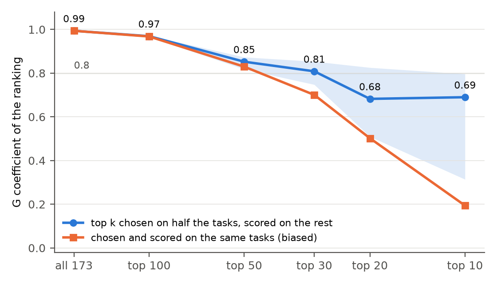
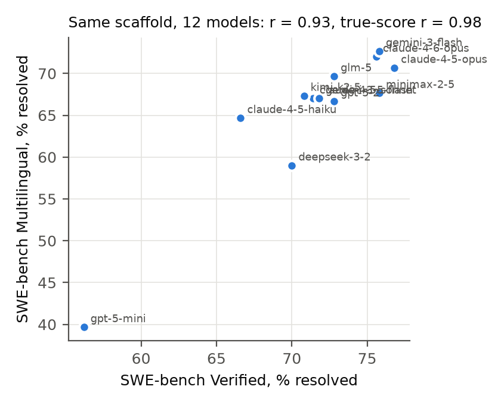

# agent-validity-ceiling

**SWE-bench Verified ranks the whole leaderboard almost perfectly (reliability 0.994) and its top 20 poorly (about 0.68). Measured against SWE-bench Multilingual, its coverage is high (0.96, or 0.80 without the weakest model), so for near transfer the limit on what the score predicts is noise more than what the benchmark leaves out.**

Part of [benchmeasure](https://github.com/abhaymettu/benchmeasure), benchmarks treated as measurement instruments: reliability (this repo), invariance ([benchdif](https://github.com/abhaymettu/benchdif)), and the scorer ([judge-reliability](https://github.com/abhaymettu/judge-reliability)). Paper: [benchmeasure.pdf](https://github.com/abhaymettu/benchmeasure/blob/main/paper/benchmeasure.pdf).



## Install

```sh
pip install git+https://github.com/abhaymettu/benchmeasure
```

## Quick start

```sh
benchmeasure demo
```

That runs the full report on the bundled SWE-bench matrices (173 public submissions by 500 tasks) in about two seconds. On your own results:

```sh
benchmeasure report results.csv            # rows are models, columns are tasks, cells 0/1
```

The original closed-form analysis in this repo needs only numpy and runs on its own:

```sh
python3 analysis.py
```

## The result

The validity ceiling is the classical attenuation bound, R^2 <= rho_X * rho_Y * C: a benchmark score can explain no more of a criterion than its own reliability, times the criterion's reliability, times the share of the criterion it covers. The first version of this repo filled those inputs from published run-to-run variance, between-model spreads read off the leaderboard by eye, and assumed coverage values. It concluded that coverage was the binding constraint. Every input is now estimated from item-level data, and that conclusion does not survive.

| compared set | model spread | reliability (G) | tasks needed for 0.9 |
| --- | --- | --- | --- |
| all 173 submissions | 19.1 pp | 0.994 | 28 |
| top 50 | 2.8 pp | 0.852 | 781 |
| top 20 | 1.6 pp | 0.682 | 2096 |
| top 10 | 1.6 pp | 0.690 | 2023 |

- **Reliability depends on the comparison.** The leaderboard's order as a whole is real. Within the leading cluster, a 1 to 2 point gap is inside the noise: none of the 19 adjacent top-20 pairs is separable by an exact McNemar test, and the smallest gap a paired test detects with 80% power is 4.3 points.
- **The naive way to compute this is biased.** Picking the top 10 and estimating their reliability on the same 500 tasks gives 0.19. The leaders were picked partly for lucky noise, which compresses their spread. Picking on half the tasks and measuring on the other half (50 random splits) gives 0.69, slightly optimistic; the correlation between task halves gives 0.61.
- **Coverage, measured.** Twelve models run with the same scaffold release on Verified and on Multilingual correlate 0.93; corrected for each score's reliability, 0.98. Coverage C = 0.96 (95% interval 0.63 to 1.00), or 0.80 without the weakest model. The earlier analysis assumed 0.25.
- **So noise, not coverage, sets the ceiling here.** In the matched set the two noise terms take 9% of the criterion's variance and uncovered variance 4%; without the weakest model, 35% against 13%. Within one population the ceiling equals the observed R^2 by construction, so its job is to attribute the shortfall. Frontier reliability (about 0.68 for the top 20) is far below the 0.94 the first version assumed.



Reproduce every number (fixed seeds, byte-for-byte test):

```sh
git clone https://github.com/abhaymettu/benchmeasure && cd benchmeasure
uv run python experiments/swebench.py      # writes results/swebench.json and the figures
uv run pytest
```

## How it works

Each public submission in [SWE-bench/experiments](https://github.com/SWE-bench/experiments) lists the tasks it resolved, which gives a models-by-tasks matrix. A two-way random effects model splits score variance into model, task and model-by-task components (generalizability theory). The G coefficient is the model share of a score's variance, and it depends on how far apart the compared models are. The validity ceiling multiplies the two reliabilities by coverage, and coverage is the squared disattenuated correlation between two benchmarks run on the same models.

## What is new compared with the closest work

- Liu et al. 2026 ([arXiv 2609.17394](https://arxiv.org/abs/2609.17394)) audited 254 public SWE-bench submissions and found no separable adjacent top-30 pair. We reproduce that count; the variance components, the reliability curve and the ceiling are what this adds.
- Hardy et al. 2026 ([arXiv 2610.00651](https://arxiv.org/abs/2610.00651)) and Srinivasan 2026 ([arXiv 2608.11323](https://arxiv.org/abs/2608.11323)) apply generalizability theory to agent benchmarks, including the 50-task SWE-bench Verified Mini. This uses the full 500 tasks, corrects the winner's-curse bias in top-k reliability, and carries reliability into a validity ceiling with measured coverage.
- Bjarnason et al. 2026 ([arXiv 2602.07150](https://arxiv.org/abs/2602.07150)) measured run-to-run SDs of 0.7 to 1.8 points on Verified. Those numbers bound how much of the single-run error is run noise.

## Limits

- One run per submission, so run noise and stable model-by-task interaction are not separated here; the published run variance bounds the split.
- Coverage rests on 12 matched models, moves with the weakest one, and measures near transfer (other languages, same task format). Nothing public measures coverage of deployment usefulness.
- Submissions are the leaderboard's population, not a random sample of systems; many share a model.
- Two upstream submissions were dropped because their per-task files contradict their reported scores.
- `analysis.py` and `writeup.md` are the original assumed-input version, kept for the record. The correction is in the paper and at the top of the writeup.

## Files

| Path | What it is |
| --- | --- |
| `analysis.py`, `results.json`, `test_reproduce.py` | the original closed-form ceiling from published inputs (numpy only) |
| `writeup.md` | the original writeup, with the November 2026 correction at the top |
| `figures/` | figures from the measured analysis in benchmeasure |
| `AGENTS.md` | notes for coding agents |

## Cite

```bibtex
@misc{mettu2026benchmeasure,
  author = {Mettu, Abhay},
  title  = {Benchmarks Are Measurement Instruments: Reliability, Invariance and Validity Ceilings for LLM and Agent Evaluation},
  year   = {2026},
  url    = {https://github.com/abhaymettu/benchmeasure}
}
```

Code under the MIT license; data from the public SWE-bench experiments repository.
